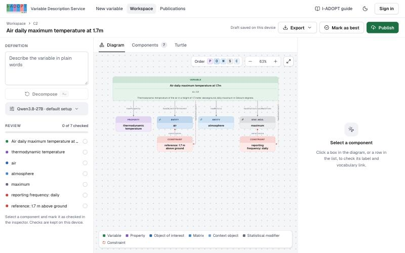

# I-ADOPT Variable Description Service

A web service that turns a sentence about a measured variable into a structured description in the
[I-ADOPT framework](https://w3id.org/iadopt/). A language model proposes the parts, a person checks and corrects them, and the
result can be exported or published as a nanopublication.

[Evaluation](docs/evaluation.md) · [Manual](docs/manual.md) · [Experiments and data](https://github.com/ArvinRastegar/i-adopt-llm-based-service)

```
number of persons receiving welfare in a statistical unit which is defined as a grouping of
homogeneous neighboring building blocks in an urban area

  property             count
  object of interest   person
  context object       urban area
  constraint           receiving welfare       (on: person)
  constraint           per statistical unit    (on: count)

The reference also has "registered as resident" (on: person), which the model missed.
```

A model answer from the [lab's record][example]: `Qwen3.8-27B`, an earlier prompt layout, Close F1 0.957. It is one of the better ones; of the same
24 variables 3 were exactly right and 7 scored zero.



The workspace, `dev` at `96f2c4b`, with a variable of the I-ADOPT corpus (CC BY 4.0) opened as Turtle, not a model answer.

Built by the GO FAIR Foundation and the Karlsruhe Institute of Technology (KIT). Technical lead and main developer: Arvin Rastegar.

## Where to look first

- **A gate before a release.** [`quality_gate.py`](backend/tools/quality_gate.py) sends 102 reference variables through the service's own
  pipeline in the running container and scores the answers with the lab's scorer. It is meant to be run by hand before `dev` is merged into `prod`;
  nothing enforces it, and it exists since 18 November 2026. 25 of the 102 are the prompt's own examples, shown with their answers, so the
  score is a floor against regressions and not the accuracy on a new variable. The [evaluation page](docs/evaluation.md) says what was
  measured, what went wrong and what the numbers do not show.
- **Tests pin the prompt.** On PSNC, the default, the rendered prompt must equal a recorded SHA-256
  ([`PROVENANCE.md`](backend/tests/fixtures/PROVENANCE.md)). OpenRouter models get an older prompt with five examples, which was not measured.
- **Answers are checked and the errors are shown.** An answer that is not valid JSON is asked again. A valid one is compared with a JSON Schema and its
  errors are shown ([`validation.py`](backend/app/services/validation.py)); it is linked and drawn all the same, because a person reviews it. For
  a link the model must answer with exactly one offered character; otherwise the question is sent again, up to three times, and then the
  label stays unlinked ([`entity_choice.py`](backend/app/services/entity_choice.py)).

## How one definition runs, on PSNC

```
definition
  -> model call with the pinned 25-example prompt       services/measured_prompt.py, llm.py
  -> JSON extraction                                    services/llm.py
  -> label and comment: a second call, never scored     services/label_comment.py
  -> schema check, errors shown                         services/validation.py
  -> links: candidates from Wikidata, QUDT and OM,
     one question per label                             services/entity_linking.py
  -> RDF/Turtle                                         services/rdf_ttl.py
  -> review in the browser -> export, or publish        services/nanopub_service.py
```

Publishing needs an account, the version that person marked as best and the ORCID iD they type in. It is permanent, so it asks for confirmation.
Backend: FastAPI and SQLite (one replica). Frontend: React and TypeScript.

## Run it locally

Needs Docker with Compose.

```bash
git clone https://github.com/ArvinRastegar/iadopt-variable-description-service.git
cd iadopt-variable-description-service
cp .env.example .env
```

In `.env` set `IADOPT_SESSION_SECRET` (for example the output of `openssl rand -hex 32`), `IADOPT_BOOTSTRAP_ADMIN_PASSWORD`, and
`IADOPT_COOKIE_SECURE=false` for plain http on your own machine. To decompose, set `PSNC_API_KEY`; with an OpenRouter key instead, set
`OPENROUTER_API_KEY`, `ENABLED_MODEL_PROVIDERS=openrouter` and `DEFAULT_MODEL_PROVIDER=openrouter`, and leave `PSNC_API_KEY` at its
placeholder, because the start check wants a value there. Without a key leave the placeholders: opening, drawing, editing and exporting
Turtle work, decomposing does not.

```bash
docker compose up --build
```

Open http://localhost:5173 and sign in as `admin` with that password. The API description is at http://localhost:5173/api/docs
after signing in.

## Tests

```bash
cd backend && python -m pip install -r requirements-dev.txt && python -m pytest tests
```

```bash
cd frontend && pnpm install --frozen-lockfile && pnpm test:unit --run && pnpm build
```

CI runs these and the container builds on every push to `dev` and every pull request to `dev` or `prod`
([`ci.yml`](.github/workflows/ci.yml)). A push to `prod` builds and publishes the images and triggers the redeployment
([`portainer-production.yml`](.github/workflows/portainer-production.yml)).

## Limits

- Decompositions and links are drafts. The [measured accuracy](docs/evaluation.md) is modest and comes from one corpus of 102 English definitions.
- The label and the comment come from a second model call that nothing has scored.
- The account roles and access rules on `dev` are not on `prod` yet.

## Licence and credits

[MIT](LICENSE), except for the parts of `frontend/` that come from the
[I-ADOPT Visualizer](https://github.com/SirkoS/iadopt-vis) by Sirko Schindler, which are under CC BY 4.0: see
[THIRD_PARTY_NOTICES.md](THIRD_PARTY_NOTICES.md). Contributors and thanks are listed on the service's start page.

[example]: https://github.com/ArvinRastegar/i-adopt-llm-based-service/blob/7405fb047e541a7c0e79670cf5f8196fe2ab5e9e/iadopt-lab/few-shot-selection/example_selection/best-configuration-session.md
