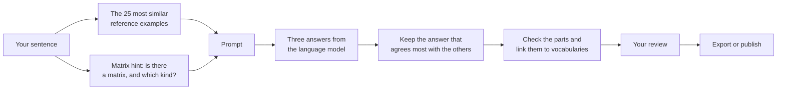

# I-ADOPT Variable Description Service

Describe what you measured in one sentence and get back a structured description that other systems can read.


Scientific data is hard to reuse when nobody knows exactly what a column means. With this service you write a plain sentence about a measured variable. A language model splits it into the parts of the [I-ADOPT framework](https://w3id.org/iadopt/) and links the parts to controlled vocabularies. You check the result, correct it, and export or publish it.

The service is built by the GO FAIR Foundation and the Karlsruhe Institute of Technology (KIT). Technical lead and main developer: Arvin Rastegar.

[Manual](docs/manual.md) · [How it is evaluated](docs/evaluation.md) · [Experiments](https://github.com/ArvinRastegar/i-adopt-llm-based-service)

## Example

You write:

> Daily mean mass concentration of dissolved oxygen in sea water at 10 m depth

You get the parts:

| Part | Value |
|---|---|
| Property | mass concentration |
| Object of interest | oxygen |
| Matrix | sea water |
| Statistical modifier | mean |
| Constraints | daily, dissolved, at 10 m depth |

## What it does

- Splits a sentence into its parts with a language model and shows the answer while it is written
- Checks the answer against a schema and shows you what is wrong with it
- Links the parts to controlled vocabularies, where the model chooses from a list of real entries
- Shows the result as a diagram you can edit, with a list of the parts and a text editor
- Exports SVG, PNG and Turtle, and publishes signed nanopublications with your ORCID iD
- Has accounts with roles, an audit log and a research export

## How it works



Before the model writes, the service looks up the 25 reference variables whose definitions are closest to yours and shows them, with their expert answers, as examples. A short first question decides whether the variable has a matrix, the medium the measured thing is in, such as sea water, and adds that hint to the prompt. The model then answers three times at once, and the service keeps the answer that agrees most with the other two. In the [evaluation lab](https://github.com/ArvinRastegar/i-adopt-llm-based-service#best-pipeline-so-far) this scored 0.694, against 0.590 with one fixed set of examples.

Model answers are drafts. A person always has the last word.

## Built with

Python, FastAPI, SQLite, React, TypeScript, Docker and GitHub Actions. More than 1,100 automated tests run in CI, and before a release the service is scored on 102 reference cases, each without its own answer among the examples.

## Run it locally

You need Docker with Compose.

```bash
git clone https://github.com/ArvinRastegar/iadopt-variable-description-service.git
cd iadopt-variable-description-service
cp .env.example .env
```

Then fill in `.env`; the comments in it say what each setting is for. Without a model key, opening, editing and exporting Turtle still work; only decomposing does not.

```bash
docker compose up --build
```

Open http://localhost:5173 and sign in as `admin` with the password you put in `.env`. The API description is at http://localhost:5173/api/docs after you sign in.

## Tests

```bash
cd backend && python -m pip install -r requirements-dev.txt && python -m pytest tests
```

```bash
cd frontend && pnpm install --frozen-lockfile && pnpm test:unit --run && pnpm build
```

## Licence and credits

[MIT](LICENSE), except for the parts of `frontend/` that come from the [I-ADOPT Visualizer](https://github.com/SirkoS/iadopt-vis) by Sirko Schindler, which are under CC BY 4.0. See [THIRD_PARTY_NOTICES.md](THIRD_PARTY_NOTICES.md). Contributors and thanks are listed on the service's start page.
